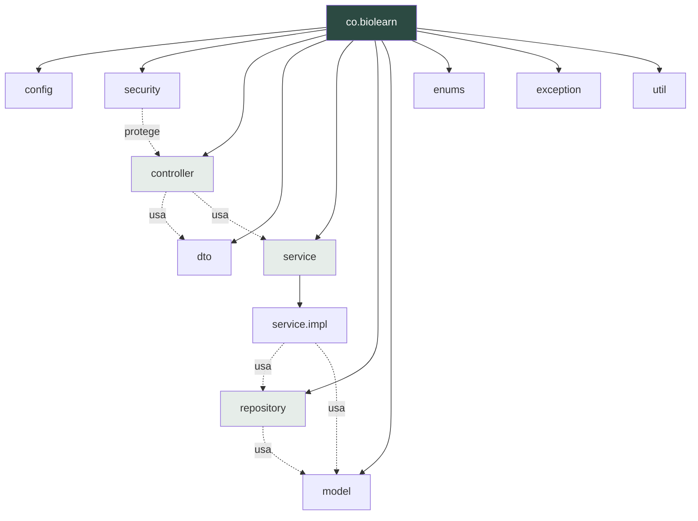
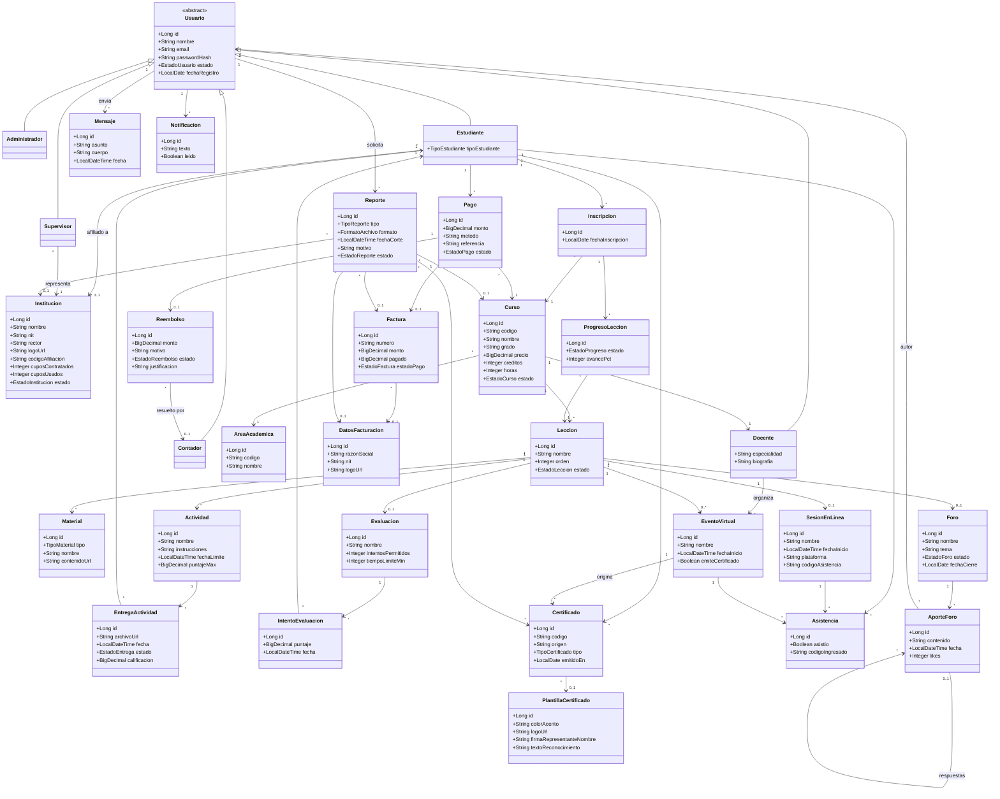
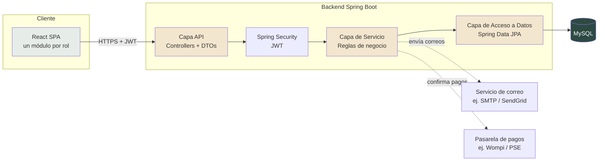

# BioLearn — Arquitectura del sistema

**Stack definido:** Java + Spring Boot (backend) · MySQL (base de datos) · React (frontend)

Este documento traduce lo ya validado en los prototipos (roles, flujos, reglas de negocio) a una arquitectura formal en capas, con sus diagramas de paquetes, clases y componentes.

---

## 1. Arquitectura en capas

| Capa | Responsabilidad | Tecnología | Ejemplos de BioLearn |
|---|---|---|---|
| **Presentación** | Interfaz de usuario, un módulo por rol | React (SPA) + React Router | Pantallas de Docente, Estudiante, Admin, etc. |
| **API / Web** | Expone los endpoints REST, valida entrada, traduce HTTP ↔ objetos internos | Spring Boot (`@RestController`), DTOs | `POST /api/cursos`, `GET /api/pagos/{id}` |
| **Seguridad (transversal)** | Autenticación y autorización | Spring Security + JWT | Login, control de acceso por rol |
| **Negocio / Servicio** | Reglas de negocio, orquestación | Spring (`@Service`) | "Al aprobar un pago, emitir factura"; "bloquear lección hasta completar la anterior" |
| **Acceso a datos** | Persistencia, consultas | Spring Data JPA (`@Repository`) | `CursoRepository`, `PagoRepository` |
| **Base de datos** | Almacenamiento | MySQL | Tablas: usuarios, cursos, pagos, facturas... |

**Por qué esta separación:** cada capa solo conoce a la que tiene justo debajo (el Controller no le habla directo a la base de datos, por ejemplo). Esto es lo que en tu lista corresponde a *"identificar las capas"* y es la base para justificar el *diagrama de componentes* y los *patrones de diseño* (ver sección 5).

---

## 2. Diagrama de paquetes

Organización del código fuente del backend (`co.biolearn`), reflejando las capas de arriba:

| Paquete | Contiene |
|---|---|
| `config` | Configuración de Spring: CORS, Swagger/OpenAPI, beans generales |
| `security` | `JwtUtil`, filtro de autenticación, `UserDetailsService` |
| `controller` | Un controlador REST por módulo: `UsuarioController`, `CursoController`, `PagoController`, `ReembolsoController`, `ForoController`... |
| `dto` | Objetos de entrada/salida de la API (nunca se exponen las entidades JPA directamente) |
| `service` / `service.impl` | Interfaces de negocio y su implementación |
| `repository` | Interfaces `JpaRepository` por entidad |
| `model` | Entidades JPA (`@Entity`) |
| `enums` | `RolUsuario`, `EstadoCurso`, `EstadoPago`, `EstadoInvitacion`... |
| `exception` | Excepciones propias + `GlobalExceptionHandler` |
| `util` | Mappers entidad↔DTO, constantes |

---

## 3. Diagrama de clases

Cubre las entidades principales de los 5 módulos de rol. Se simplificaron algunas tablas de detalle (opciones de pregunta, destinatarios de mensaje) para legibilidad; quedan documentadas en el diccionario de datos que hacemos en el siguiente paso.

**Usuario y sus roles:** en vez de un único `Usuario` con un campo `rol`, se modela como **generalización**: `Usuario` es la clase base abstracta con los datos comunes (credenciales, nombre, estado), y `Administrador`, `Docente`, `Contador`, `Supervisor` y `Estudiante` son subclases que heredan de ella y agregan solo lo que les es propio (ej. `Estudiante` tiene `tipoEstudiante`, `Supervisor` está ligado a una `Institucion`). En el `schema.sql` definitivo esto se traduce con una **tabla de perfil por rol** (`perfil_docente`, `perfil_estudiante`, `perfil_contador`, `perfil_admin`, `supervisor_institucion`), cada una con su **propio ID autoincremental** y una columna `id_usuario` con restricción `UNIQUE` que la enlaza 1 a 1 con `usuario` (en JPA/Hibernate, una relación `@OneToOne` con llave foránea única, en vez de la estrategia `JOINED` de PK compartida). La ventaja frente a una sola tabla plana se mantiene igual: la base de datos garantiza por diseño que, por ejemplo, solo un estudiante real pueda aparecer en una `inscripcion`.

---

## 3.1 Diagrama Entidad-Relación (diseño físico)

El diagrama anterior es UML (conceptual, sin FK explícitas). Para el diseño físico de la base de datos, con llaves primarias y foráneas visibles en cada tabla —igual que se documentó en el diccionario de datos—, se generó un **diagrama ER completo y verificado, cubriendo las 45 tablas sin omitir ninguna**, construido directamente a partir de `schema.sql` para garantizar que coincida al 100% con el script real. Cada uno de los 8 dominios se validó renderizándolo, así que no es solo texto de Mermaid sin probar.

📄 Ver documento completo: **BioLearn — Diagrama ER completo (45 tablas)**

---

## 4. Diagrama de componentes

Cómo se comunican las piezas grandes del sistema (frontend, backend por capas, base de datos, y los servicios externos que en los prototipos estaban *simulados*):

**Nota:** `MAIL` y `PAGO` son justo lo que en los prototipos aparecía simulado con un `toast()` ("Factura enviada al correo...", "Pago confirmado..."). En el sistema real son integraciones externas reales que la capa de Servicio invoca.

---

## 5. Patrones de diseño que aplican (adelanto del punto 18 de tu lista)

| Patrón | Dónde se usa |
|---|---|
| **MVC** (a nivel general) | Controller (API) → Service (lógica) → Repository/Model (datos) |
| **Repository** | Toda la capa `repository`, vía Spring Data JPA |
| **DTO (Data Transfer Object)** | Para no exponer las entidades JPA directamente en la API |
| **Factory** | Creación de notificaciones/mensajes según el tipo de evento |
| **Strategy** | Cálculo de estado de lección (bloqueada/en progreso/completada) según reglas distintas por tipo de curso |
| **Observer** (vía eventos de Spring) | Ej: al aprobar un pago → emitir factura → notificar al estudiante, sin acoplar esos tres pasos directamente |
| **Singleton** | Beans de Spring por defecto (`@Service`, `@Component` son singleton) |

---

## 6. Próximos pasos sugeridos

1. **Diccionario de datos** completo (todas las columnas, tipos, tamaños, llaves foráneas) — a partir del diagrama de clases de arriba.
2. **Mecanismos de seguridad** en detalle (JWT, hash de contraseñas, control de acceso por rol, HTTPS).
3. **Mapa de navegación formal** (ya está implícito en los menús de cada prototipo — lo paso a diagrama).
4. Configuración del **entorno de desarrollo**: IDE, Git, servidor local, MySQL.
5. Empezar a codificar por el módulo más pequeño (Auth) para validar la arquitectura de punta a punta antes de escalar a los demás.
