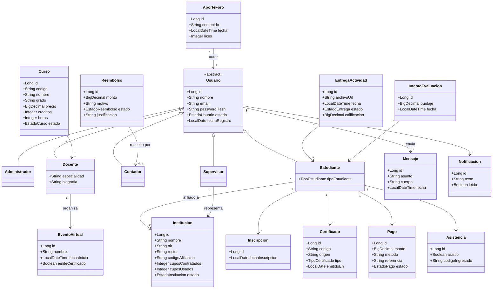
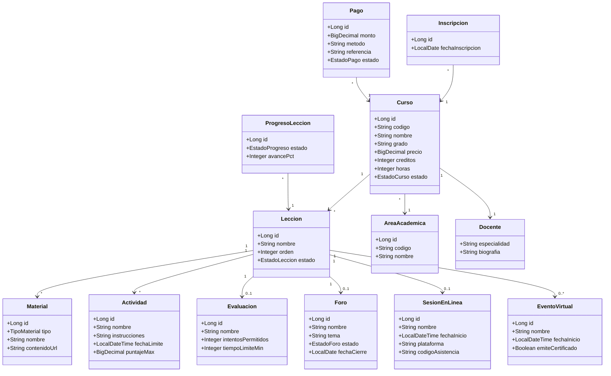
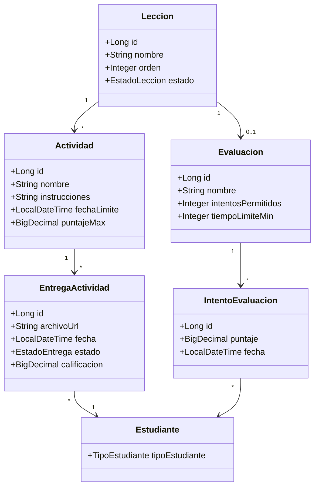
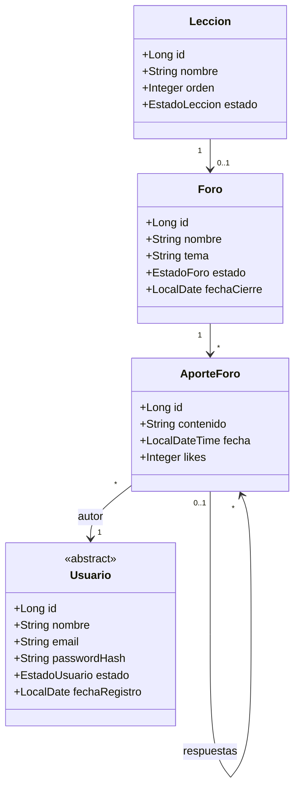
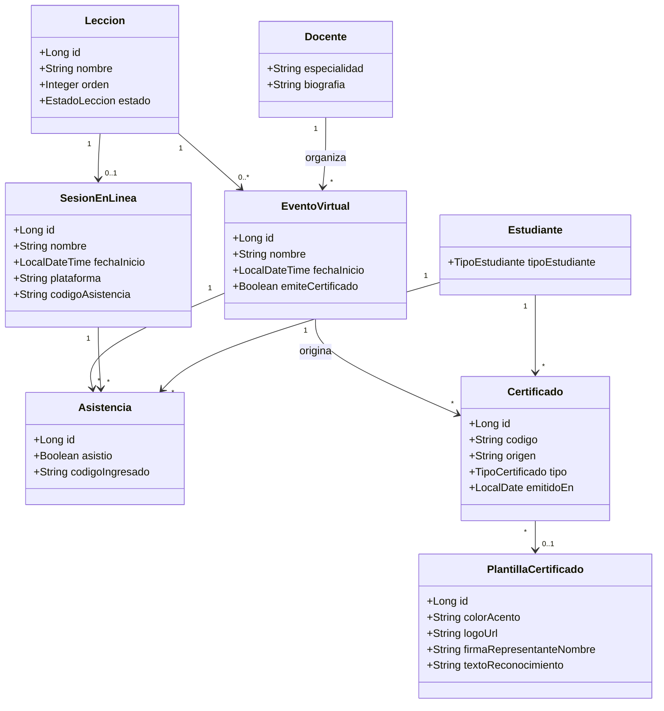
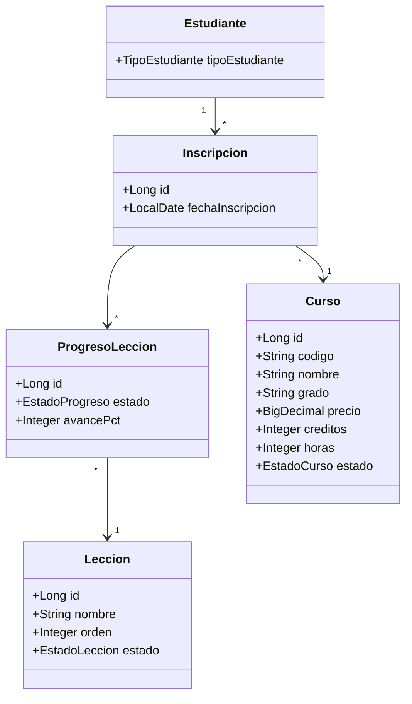
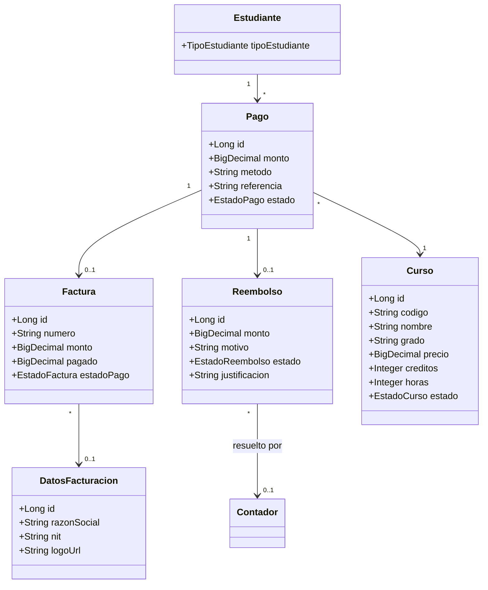
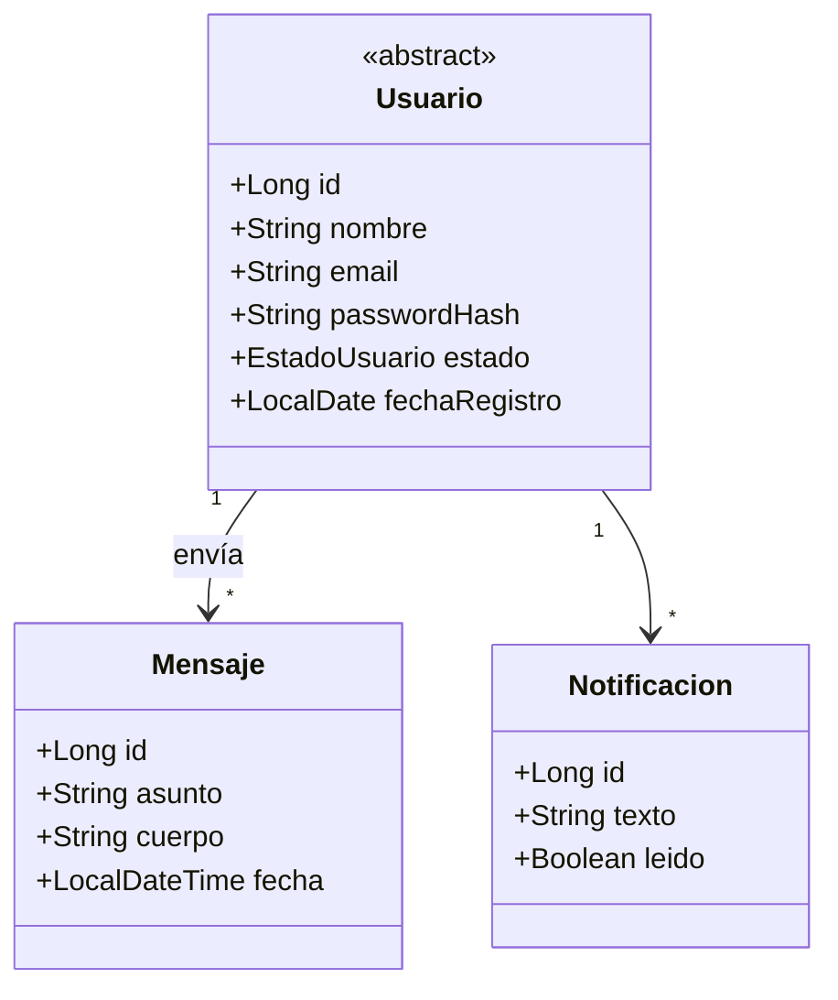

# BioLearn — Diagrama de clases dividido por dominio

El mismo diagrama de clases del documento de arquitectura, separado en los mismos 8 dominios usados en el diccionario de datos y el diagrama ER — para que sea más fácil de leer que la versión única con las 30 clases juntas. Las clases marcadas aparecen también en otro dominio porque son el punto de conexión entre ambos (se resalta en el texto).

## Dominio 1: Usuarios Seguridad Perfiles

*Se conecta con: `AporteForo`, `Asistencia`, `Certificado`, `Curso`, `EntregaActividad`, `EventoVirtual`, `Inscripcion`, `IntentoEvaluacion`, `Mensaje`, `Notificacion`, `Pago`, `Reembolso` (de otro dominio).*

## Dominio 2: Cursos Contenido Academico

*Se conecta con: `Actividad`, `Docente`, `Evaluacion`, `EventoVirtual`, `Foro`, `Inscripcion`, `Pago`, `ProgresoLeccion`, `SesionEnLinea` (de otro dominio).*

## Dominio 3: Actividades Evaluaciones

*Se conecta con: `Estudiante`, `Leccion` (de otro dominio).*

## Dominio 4: Foros

*Se conecta con: `Leccion`, `Usuario` (de otro dominio).*

## Dominio 5: Sesiones Eventos Certificados

*Se conecta con: `Docente`, `Estudiante`, `Leccion` (de otro dominio).*

## Dominio 6: Inscripciones Progreso

*Se conecta con: `Curso`, `Estudiante`, `Leccion` (de otro dominio).*

## Dominio 7: Finanzas

*Se conecta con: `Contador`, `Curso`, `Estudiante` (de otro dominio).*

## Dominio 8: Comunicacion Reportes

*Se conecta con: `Usuario` (de otro dominio).*

