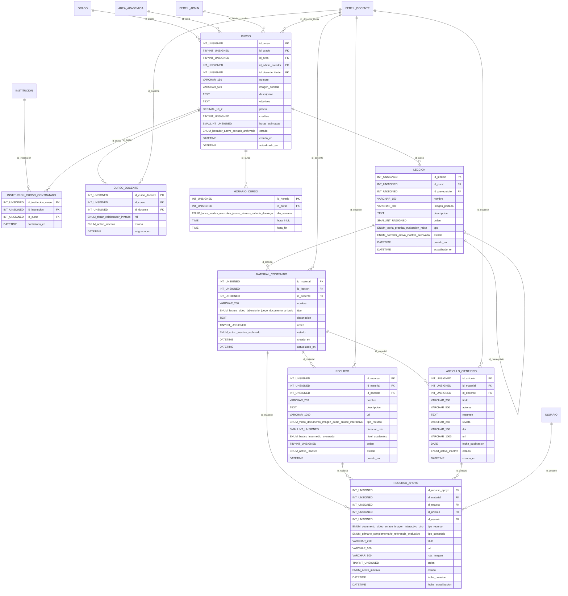
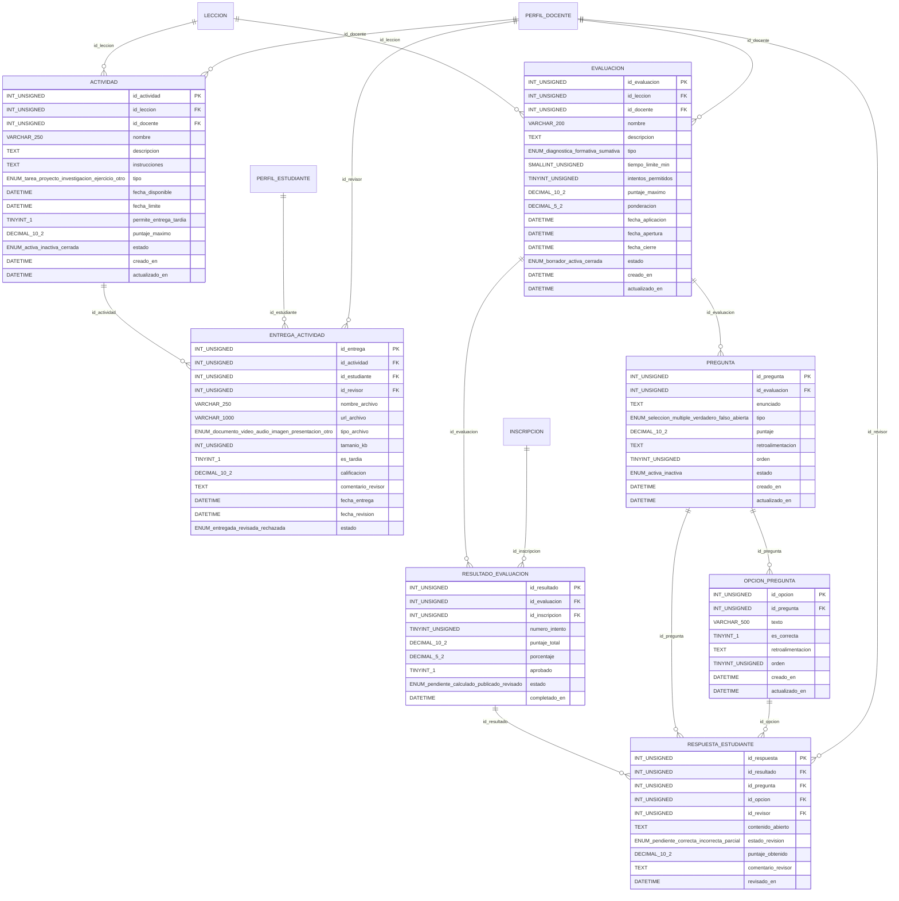
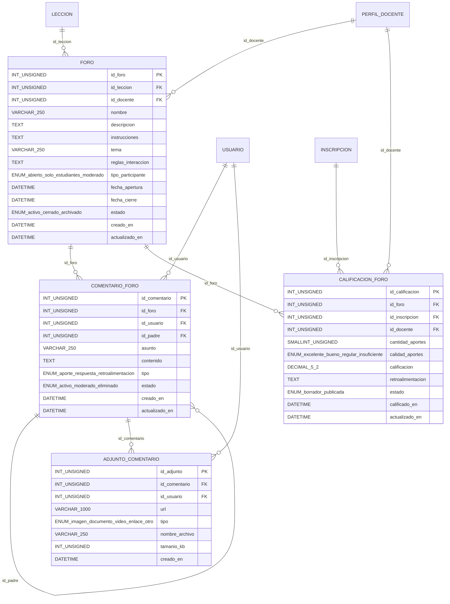
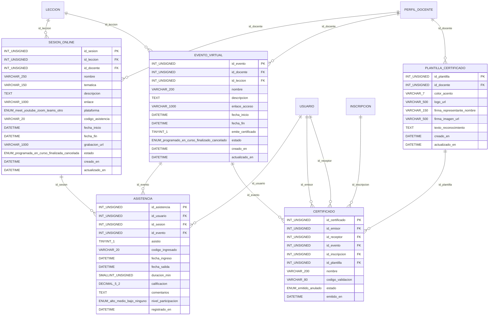
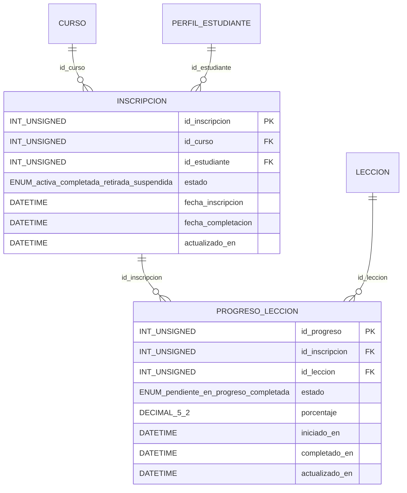
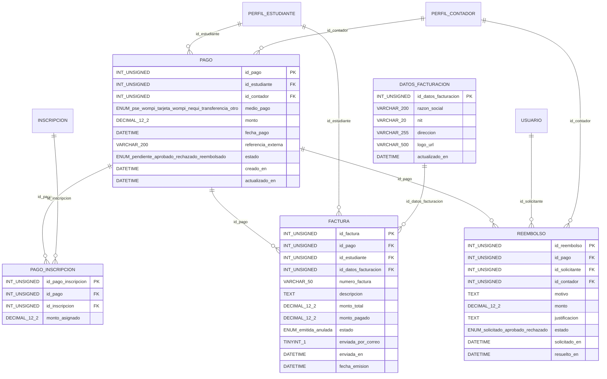

# BioLearn — Diagrama Entidad-Relación (esquema final, 51 tablas)

Generado directamente desde `biolearn_database.sql`. Dividido en los mismos 8 dominios del diccionario de datos.

## Dominio 1: Usuarios Seguridad Perfiles

```mermaid
erDiagram
    USUARIO ||--o{ HISTORIAL_ACCESO : "id_usuario"
    USUARIO ||--o{ SESION_OTP : "id_usuario"
    USUARIO ||--o{ VERIFICACION_CUENTA : "id_usuario"
    USUARIO ||--o{ RECUPERACION_CONTRASENA : "id_usuario"
    USUARIO ||--o{ PERFIL_ADMIN : "id_usuario"
    USUARIO ||--o{ PERFIL_DOCENTE : "id_usuario"
    USUARIO ||--o{ PERFIL_CONTADOR : "id_usuario"
    USUARIO ||--o{ PERFIL_ESTUDIANTE : "id_usuario"
    INSTITUCION ||--o{ PERFIL_ESTUDIANTE : "id_institucion"
    GRADO ||--o{ PERFIL_ESTUDIANTE : "id_grado"
    AREA_ACADEMICA ||--o{ PERFIL_ESTUDIANTE : "id_area"
    USUARIO ||--o{ SUPERVISOR_INSTITUCION : "id_usuario"
    INSTITUCION ||--o{ SUPERVISOR_INSTITUCION : "id_institucion"
    PERFIL_ESTUDIANTE ||--o{ HISTORIAL_GRADO : "id_estudiante"
    GRADO ||--o{ HISTORIAL_GRADO : "id_grado"
    INSTITUCION ||--o{ HISTORIAL_GRADO : "id_institucion"
    USUARIO {
        INT_UNSIGNED id_usuario PK
        VARCHAR_100 nombre
        VARCHAR_100 apellido
        VARCHAR_60 nombre_usuario
        VARCHAR_150 correo
        VARCHAR_255 contrasena
        ENUM_admin_docente_estudiante_supervisor_contador tipo_usuario
        ENUM_pendiente_activo_inactivo_suspendido estado
        VARCHAR_30 doc_identidad
        DATE fecha_nacimiento
        VARCHAR_20 telefono
        VARCHAR_200 direccion
        VARCHAR_100 ciudad
        VARCHAR_500 foto_perfil
        VARCHAR_100 rol_detalle
        DATETIME fecha_registro
        DATETIME fecha_actualizacion
    }
    AREA_ACADEMICA {
        TINYINT_UNSIGNED id_area PK
        VARCHAR_100 nombre
        TEXT descripcion
        ENUM_activo_inactivo estado
        DATETIME fecha_creacion
        DATETIME fecha_actualizacion
    }
    GRADO {
        TINYINT_UNSIGNED id_grado PK
        VARCHAR_60 nombre
        ENUM_primaria_secundaria_media nivel
        TINYINT_UNSIGNED orden
        TEXT descripcion
        ENUM_activo_inactivo estado
        DATETIME fecha_creacion
        DATETIME fecha_actualizacion
    }
    HISTORIAL_ACCESO {
        INT_UNSIGNED id_historial PK
        INT_UNSIGNED id_usuario FK
        ENUM_login_logout_fallo_login_cambio_contrasena accion
        ENUM_exitosa_fallida_expirada estado_sesion
        VARCHAR_45 ip_origen
        VARCHAR_150 dispositivo
        VARCHAR_100 navegador
        VARCHAR_100 ubicacion
        SMALLINT_UNSIGNED duracion_minutos
        VARCHAR_64 hash_token_sesion
        DATETIME fecha_acceso
    }
    SESION_OTP {
        INT_UNSIGNED id_sesion_otp PK
        INT_UNSIGNED id_usuario FK
        CHAR_6 codigo
        DATETIME expira_en
        TINYINT_1 usado
        DATETIME creado_en
    }
    VERIFICACION_CUENTA {
        INT_UNSIGNED id_verificacion PK
        INT_UNSIGNED id_usuario FK
        VARCHAR_128 token
        ENUM_activacion_cambio_correo tipo
        ENUM_pendiente_usado_expirado estado
        DATETIME expira_en
        DATETIME usado_en
        DATETIME creado_en
    }
    RECUPERACION_CONTRASENA {
        INT_UNSIGNED id_recuperacion PK
        INT_UNSIGNED id_usuario FK
        VARCHAR_128 token
        ENUM_pendiente_usado_expirado estado
        VARCHAR_45 ip_solicitud
        DATETIME expira_en
        DATETIME usado_en
        DATETIME creado_en
    }
    INSTITUCION {
        INT_UNSIGNED id_institucion PK
        VARCHAR_200 nombre
        VARCHAR_20 nit
        VARCHAR_200 rector
        VARCHAR_300 direccion
        VARCHAR_20 telefono
        VARCHAR_150 correo
        VARCHAR_500 logo_url
        CHAR_8 codigo_afiliacion
        SMALLINT_nullable cupos_contratados
        ENUM_activa_inactiva_suspendida estado
        DATETIME creado_en
        DATETIME actualizado_en
    }
    PERFIL_ADMIN {
        INT_UNSIGNED id_admin PK
        INT_UNSIGNED id_usuario FK
        ENUM_superadmin_admin_institucional_admin_contenido rol_admin
        ENUM_activo_inactivo estado
        DATETIME asignado_en
        DATETIME actualizado_en
    }
    PERFIL_DOCENTE {
        INT_UNSIGNED id_docente PK
        INT_UNSIGNED id_usuario FK
        VARCHAR_150 especialidad
        TEXT experiencia_laboral
        ENUM_planta_contratista_honorarios tipo_contrato
        ENUM_activo_inactivo_suspendido estado
        DATETIME asignado_en
        DATETIME actualizado_en
    }
    PERFIL_CONTADOR {
        INT_UNSIGNED id_contador PK
        INT_UNSIGNED id_usuario FK
        ENUM_administrador_financiero_auxiliar_auditor rol_contador
        ENUM_activo_inactivo estado
        DATETIME asignado_en
        DATETIME actualizado_en
    }
    PERFIL_ESTUDIANTE {
        INT_UNSIGNED id_estudiante PK
        INT_UNSIGNED id_usuario FK
        INT_UNSIGNED id_institucion FK
        TINYINT_UNSIGNED id_grado FK
        TINYINT_UNSIGNED id_area FK
        ENUM_activo_inactivo_egresado estado
        DATE fecha_ingreso
        DATETIME actualizado_en
    }
    SUPERVISOR_INSTITUCION {
        INT_UNSIGNED id_supervisor_inst PK
        INT_UNSIGNED id_usuario FK
        INT_UNSIGNED id_institucion FK
        VARCHAR_150 cargo
        TINYINT_1 acceso_reportes
        TINYINT_1 acceso_foros
        ENUM_activo_inactivo_suspendido estado
        DATETIME asignado_en
        DATETIME actualizado_en
    }
    HISTORIAL_GRADO {
        INT_UNSIGNED id_historial_grado PK
        INT_UNSIGNED id_estudiante FK
        TINYINT_UNSIGNED id_grado FK
        INT_UNSIGNED id_institucion FK
        DATE fecha_inicio
        DATE fecha_fin
        TEXT observaciones
        DATETIME registrado_en
    }
```

## Dominio 2: Cursos Contenido Academico

## Dominio 3: Actividades Evaluaciones

## Dominio 4: Foros

## Dominio 5: Sesiones Eventos Certificados

## Dominio 6: Inscripciones Progreso

## Dominio 7: Finanzas

## Dominio 8: Comunicacion Reportes

```mermaid
erDiagram
    USUARIO ||--o{ MENSAJE : "id_emisor"
    USUARIO ||--o{ MENSAJE : "id_receptor"
    CURSO ||--o{ MENSAJE : "id_curso"
    USUARIO ||--o{ NOTIFICACION : "id_usuario_emisor"
    USUARIO ||--o{ NOTIFICACION : "id_usuario"
    USUARIO ||--o{ REPORTE : "id_solicitante"
    CURSO ||--o{ REPORTE : "id_curso"
    INSCRIPCION ||--o{ REPORTE : "id_inscripcion"
    INSTITUCION ||--o{ REPORTE : "id_institucion"
    SUPERVISOR_INSTITUCION ||--o{ REPORTE : "id_supervisor_inst"
    PERFIL_CONTADOR ||--o{ REPORTE : "id_contador"
    FACTURA ||--o{ REPORTE : "id_factura"
    DATOS_FACTURACION ||--o{ REPORTE : "id_datos_facturacion"
    REPORTE ||--o{ REPORTE_CERTIFICADO : "id_reporte"
    CERTIFICADO ||--o{ REPORTE_CERTIFICADO : "id_certificado"
    USUARIO ||--o{ RETROALIMENTACION : "id_usuario_emisor"
    USUARIO ||--o{ RETROALIMENTACION : "id_usuario_receptor"
    RESPUESTA_ESTUDIANTE ||--o{ RETROALIMENTACION : "id_respuesta"
    RESULTADO_EVALUACION ||--o{ RETROALIMENTACION : "id_resultado"
    ASISTENCIA ||--o{ RETROALIMENTACION : "id_asistencia"
    COMENTARIO_FORO ||--o{ RETROALIMENTACION : "id_comentario"
    CALIFICACION_FORO ||--o{ RETROALIMENTACION : "id_calificacion_foro"
    ENTREGA_ACTIVIDAD ||--o{ RETROALIMENTACION : "id_entrega"
    MENSAJE {
        INT_UNSIGNED id_mensaje PK
        INT_UNSIGNED id_emisor FK
        INT_UNSIGNED id_receptor FK
        INT_UNSIGNED id_curso FK
        VARCHAR_200 asunto
        TEXT contenido
        TINYINT_1 leido
        DATETIME leido_en
        ENUM_activo_eliminado estado_emisor
        ENUM_activo_eliminado estado_receptor
        DATETIME enviado_en
    }
    NOTIFICACION {
        INT_UNSIGNED id_notificacion PK
        INT_UNSIGNED id_usuario FK
        INT_UNSIGNED id_usuario_emisor FK
        ENUM_pago_inscripcion_leccion_evaluacion_foro_mensaje_certificado_reembolso_sistema tipo
        INT_UNSIGNED entidad_id
        VARCHAR_200 titulo
        TEXT contenido
        ENUM_pendiente_enviada_leida_archivada estado_notificacion
        TINYINT_1 leida
        DATETIME leida_en
        DATETIME creada_en
    }
    REPORTE {
        INT_UNSIGNED id_reporte PK
        INT_UNSIGNED id_solicitante FK
        INT_UNSIGNED id_curso FK
        INT_UNSIGNED id_inscripcion FK
        INT_UNSIGNED id_institucion FK
        INT_UNSIGNED id_supervisor_inst FK
        INT_UNSIGNED id_contador FK
        INT_UNSIGNED id_factura FK
        INT_UNSIGNED id_datos_facturacion FK
        ENUM_academico_financiero_institucional_mixto tipo
        ENUM_pdf_excel_csv formato
        DATETIME fecha_corte
        TEXT motivo
        TEXT descripcion
        LONGTEXT contenido
        ENUM_pendiente_generado_validado_cerrado estado
        DATETIME creado_en
        DATETIME actualizado_en
    }
    REPORTE_CERTIFICADO {
        INT_UNSIGNED id_reporte PK,FK
        INT_UNSIGNED id_certificado PK,FK
        TINYINT_1 incluido_en_calculo
        TEXT observaciones
    }
    RETROALIMENTACION {
        INT_UNSIGNED id_retroalimentacion PK
        INT_UNSIGNED id_usuario_emisor FK
        INT_UNSIGNED id_usuario_receptor FK
        INT_UNSIGNED id_respuesta FK
        INT_UNSIGNED id_resultado FK
        INT_UNSIGNED id_asistencia FK
        INT_UNSIGNED id_comentario FK
        INT_UNSIGNED id_calificacion_foro FK
        INT_UNSIGNED id_entrega FK
        TEXT comentarios
        TEXT sugerencias
        ENUM_borrador_enviada_leida_archivada estado
        DATETIME fecha_retroalimentacion
        DATETIME fecha_actualizacion
    }
```

