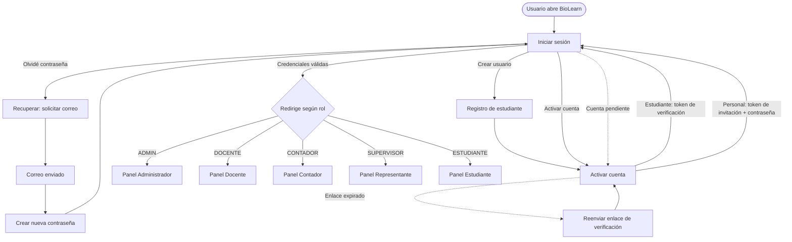
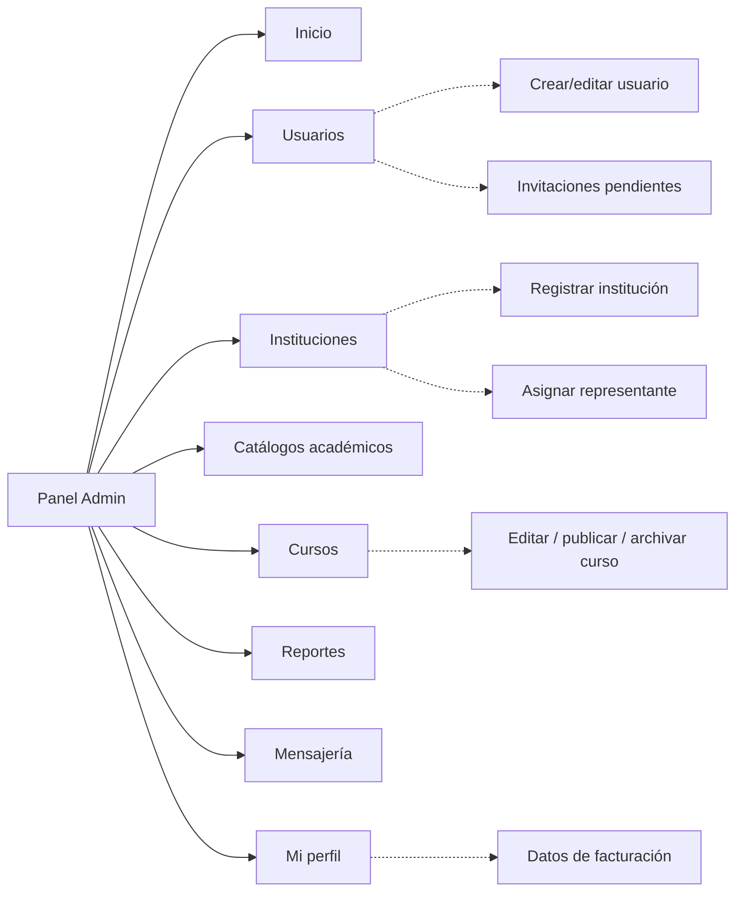
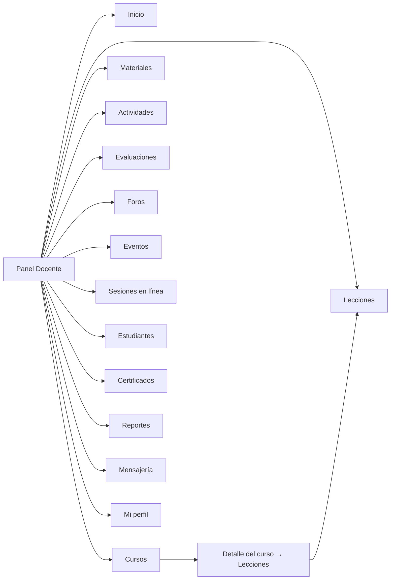
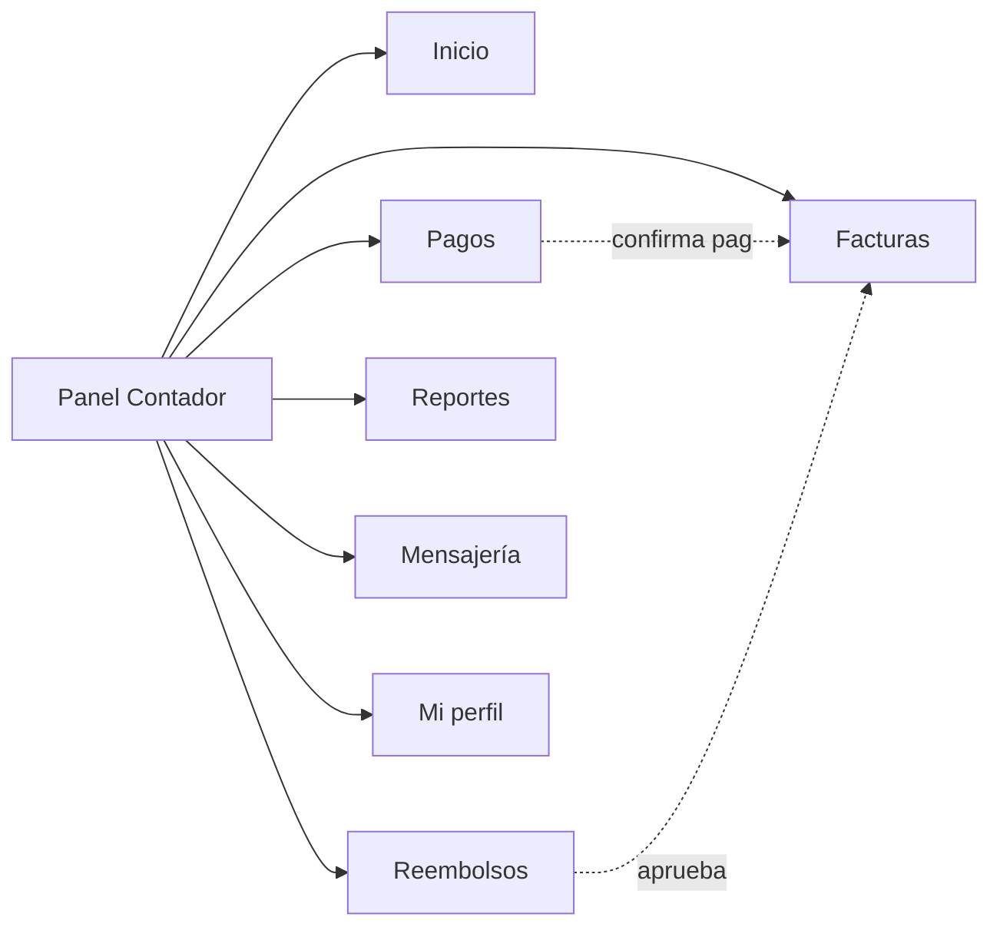
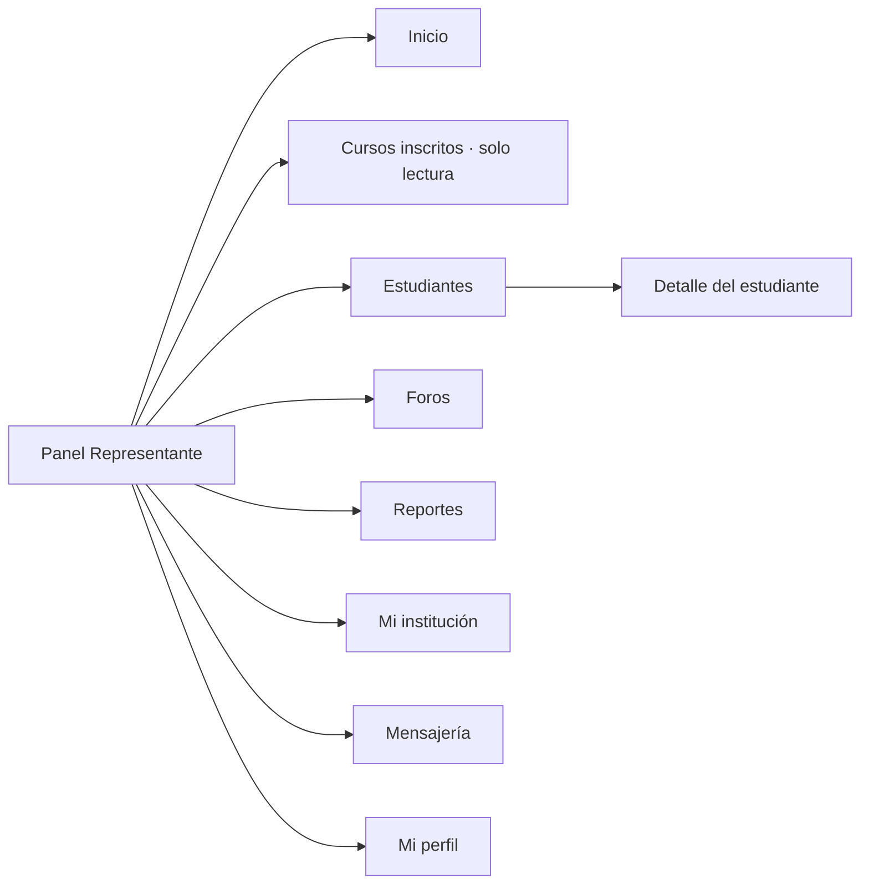
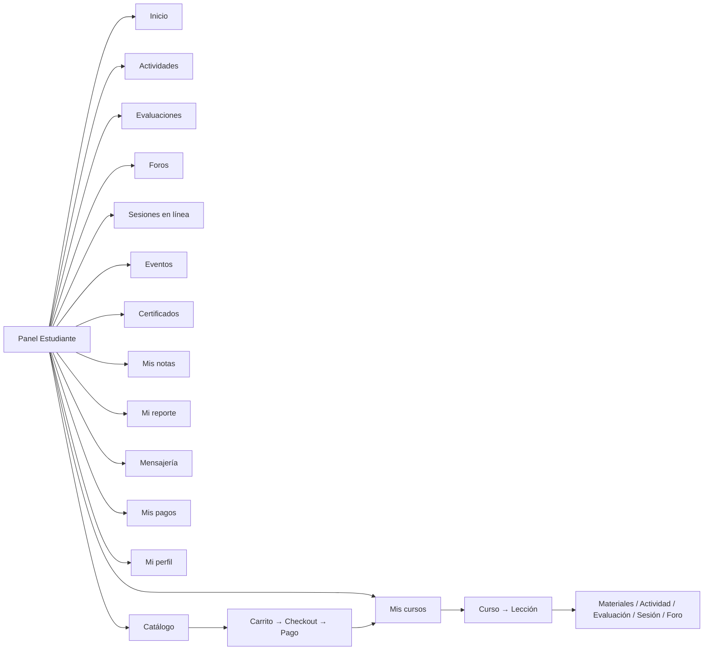

# BioLearn — Mapa de navegación

Basado directamente en los menús (`NAV`) que ya implementamos y probamos en cada uno de los 6 prototipos.

## Punto de entrada único

---

## Administrador

## Docente

## Contador

## Representante institucional (Supervisor)

## Estudiante

---

## Reglas de navegación transversales (ya validadas en los prototipos)

- Una **lección se bloquea** hasta completar la anterior (Estudiante).
- Un **estudiante independiente** no ve `Mi institución`; solo aparece si está afiliado.
- **Docente, Contador y Supervisor** llegan al sistema únicamente por invitación — no pasan por la pantalla de registro público.
- Cerrar sesión desde cualquier módulo regresa siempre a `Iniciar sesión`.
